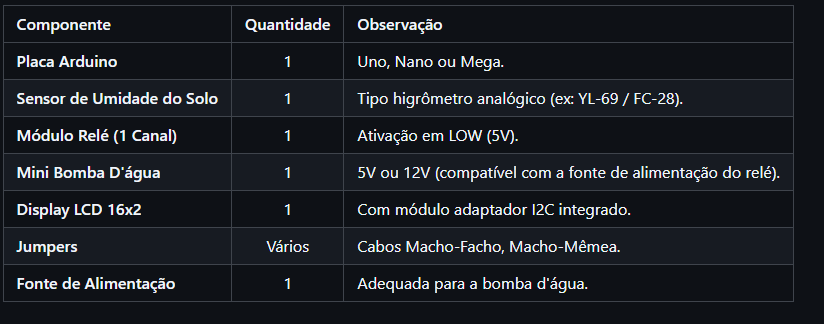
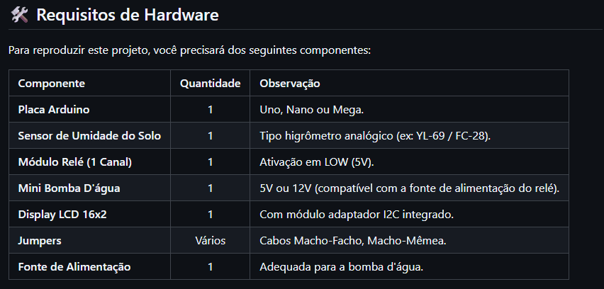
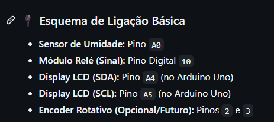

# 🌿 Sistema de Irrigação Automática Inteligente

Projeto de automação com Arduino voltado à irrigação de plantas com base na leitura da umidade do solo.

> **Status da documentação:** este repositório inicial foi preparado a partir das informações e imagens de documentação enviadas pelo autor. O código-fonte ainda precisa ser adicionado e as ligações devem ser conferidas com a montagem física antes de considerar este guia como definitivo.

## 🎥 Demonstração

[Assista ao vídeo de demonstração no YouTube](https://www.youtube.com/watch?v=ccz40w9uSMc)

## 🧰 Componentes listados

| Componente | Quantidade | Observação da documentação |
|---|---:|---|
| Placa Arduino | 1 | Uno, Nano ou Mega |
| Sensor de umidade do solo | 1 | Sensor analógico, por exemplo YL-69 / FC-28 |
| Módulo relé de 1 canal | 1 | Documentado como ativação em LOW (5 V) |
| Mini bomba d'água | 1 | 5 V ou 12 V, compatível com a fonte |
| Display LCD 16×2 | 1 | Com adaptador I²C integrado |
| Jumpers | Vários | Macho-fêmea e macho-macho |
| Fonte de alimentação | 1 | Adequada à bomba |

## 🔌 Ligações indicadas na documentação

- Sensor de umidade: `A0`
- Sinal do módulo relé: pino digital `10`
- LCD I²C — SDA: `A4` no Arduino Uno
- LCD I²C — SCL: `A5` no Arduino Uno
- Encoder rotativo: citado como opcional/futuro (`2` e `3`); não é apresentado aqui como função implementada.

**Atenção:** confirme as conexões na sua montagem e no código antes de ligar a alimentação. Não alimente a bomba diretamente por um pino do Arduino; use alimentação apropriada e o módulo de acionamento adequado.

## 🖼️ Documentação visual

As imagens abaixo são capturas da documentação do projeto enviadas pelo autor, não fotografias da montagem física.

### Componentes de hardware

### Requisitos de hardware

### Esquema de ligação básica

## ▶️ Como reproduzir

1. Reúna os componentes compatíveis listados acima.
2. Confira as ligações com o esquema e com o código real.
3. Abra o arquivo `.ino` no Arduino IDE.
4. Instale as bibliotecas exigidas pelo código, caso existam.
5. Selecione a placa e a porta corretas e carregue o programa.
6. Teste com cuidado a alimentação da bomba e do módulo relé.

> Os passos acima são orientações gerais. Os detalhes de configuração e as bibliotecas serão completados depois da inclusão do código-fonte.

## 🚀 Próximas melhorias na documentação

- [ ] Adicionar o código Arduino original.
- [ ] Incluir fotos reais da montagem e do circuito.
- [ ] Registrar as bibliotecas e a placa efetivamente utilizadas.
- [ ] Descrever os testes observados no vídeo.
- [ ] Confirmar o comportamento de acionamento da bomba e os limites de umidade, se aplicável.

## 👨‍💻 Autor

José Braz — estudante de Ciência da Computação.
